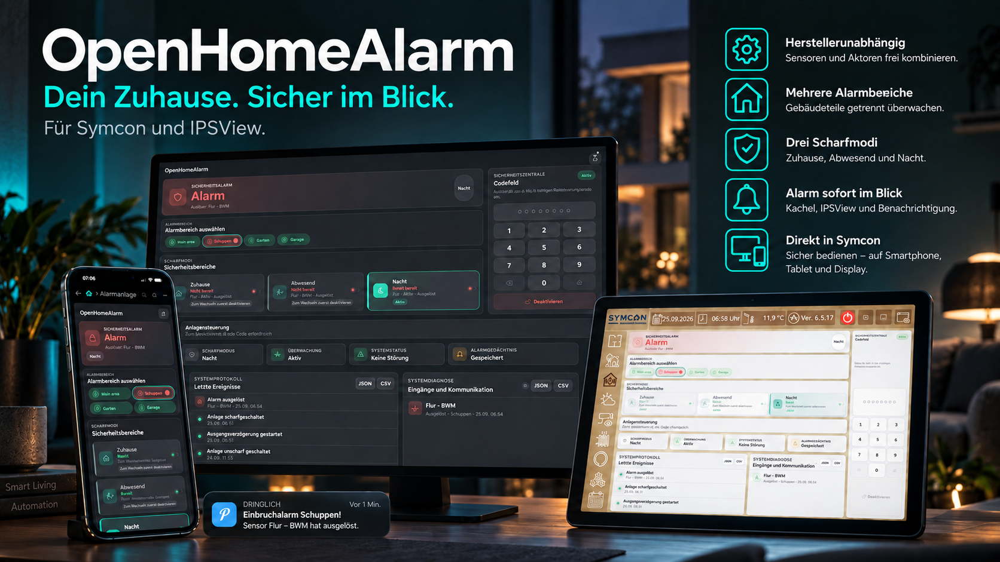
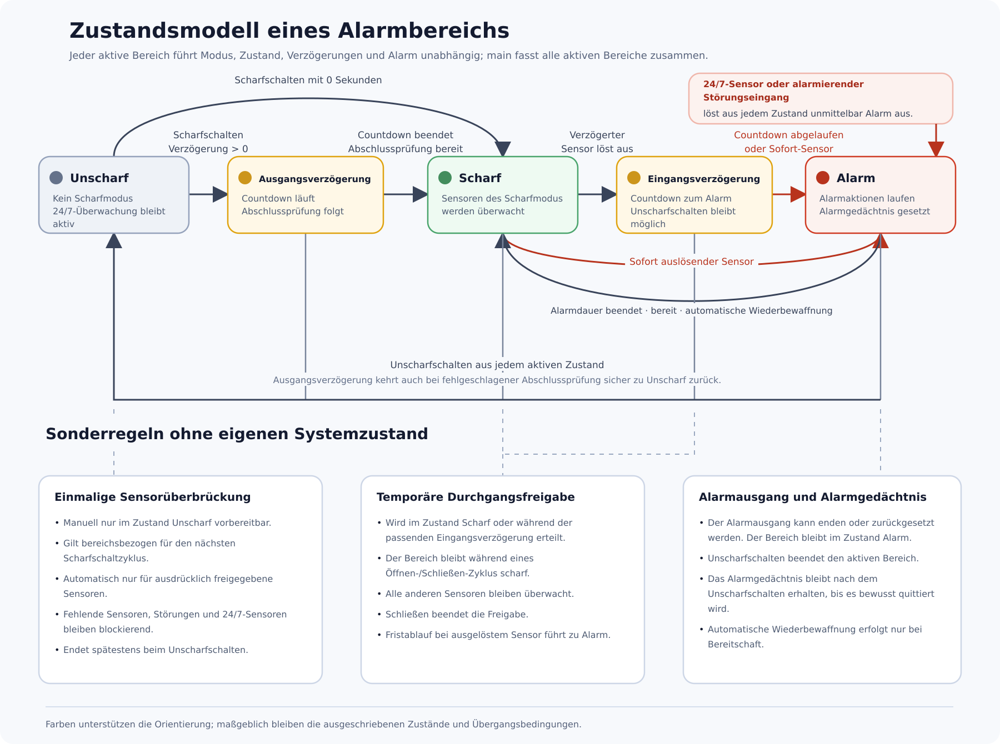

# OpenHomeAlarm



OpenHomeAlarm ist eine herstellerunabhängige Alarm- und Sicherheitszentrale für die Hausautomation auf Basis von Symcon.

Vorhandene Symcon-Variablen können unabhängig von Hersteller und Protokoll als Sensoren, 24/7-Auslöser oder technische Störungseingänge verwendet werden. Das Modul stellt unabhängige Alarmbereiche, wiederanlaufsichere Verzögerungen mit optionaler Countdown-Ausgabe, Sensorüberbrückungen, einmalige zeitbegrenzte Durchgangsfreigaben, eine optionale Aktion nach dem vollständigen Unscharfschalten, wöchentliche automatische Scharfschaltung, nach Alarmierungsart und Auslösekategorie steuerbare Alarm-Eskalationsstufen, native Symcon- und direkte Pushover-Benachrichtigungen, benutzerbezogene Unscharfschaltcodes, Alarmgedächtnis, Ereignis- und Diagnoseexporte sowie eine versionierte Konfigurationssicherung bereit. Bedient wird es über die öffentliche API, eine responsive HTML-SDK-Kachel oder die IPSView-WebContent-Seite.

Gleichnamige Sensor- und Störungsvariablen bleiben anhand ihrer Variablen-IDs
intern getrennt. In Ansichten stehen konfigurierte Namen beziehungsweise die
aktuellen Symcon-Namen, keine automatisch ergänzten IDs.

> [!WARNING]
> OpenHomeAlarm ist keine zertifizierte Einbruch-, Brand- oder Gefahrenmeldeanlage nach EN-50131. Funktion und Verfügbarkeit hängen von Symcon, dem Hostsystem, dem Netzwerk, den eingebundenen Geräten und den konfigurierten Aktionen ab. Für normativ oder versicherungsrechtlich geforderte Schutzaufgaben ist geeignete zertifizierte Sicherheitstechnik erforderlich.

## Module

- **OpenHomeAlarm** – zentrale Alarm- und Sicherheitslogik ([Dokumentation](OpenHomeAlarm))

## Voraussetzungen

- Symcon ab Version 9.0

## Schnellstart

1. Library installieren und eine **OpenHomeAlarm**-Instanz anlegen.
2. Den vorhandenen Bereich `main` aktiv belassen. Er ist fest die Gesamtanlage;
   zusätzliche Bereiche können einzeln geschaltet werden.
3. Unter **Sensoren und Auslöser** Variablen hinzufügen, einem oder mehreren
   Bereichen zuordnen und die gewünschten Modi (**Zuhause**, **Abwesend**,
   **Nacht**) aktivieren. Bei mehrwertigen Zustandsvariablen kann alternativ
   ein sicherer Normalwert gewählt werden; jede Abweichung gilt dann als
   Auslösung.
4. In Kachel oder IPSView den gewünschten Bereich über Namen beziehungsweise
   Status anzeigen. Bei mindestens drei Bereichen können über den separaten
   Auswahlkreis im selben Bereichsbutton auch mehrere Bereiche für die nächste
   gemeinsame Scharfschaltung markiert werden. `main` steht dabei für alle
   aktiven Bereiche und ersetzt einzelne Markierungen.
5. Mit einem Testlauf prüfen, ob Sensorblocker, Unscharfschaltung und Aktionen
   wie erwartet funktionieren.

Unter **Ansicht → Sichtbare Bedienelemente** kann die gemeinsame Kachel- und
IPSView-Ausgabe bei Bedarf vereinfacht werden. Der zuletzt angezeigte
Alarmbereich wird lokal auf dem jeweiligen Bediengerät gemerkt.

## Zustandsmodell

Jeder aktive Alarmbereich durchläuft unabhängig die Zustände **Unscharf**,
**Ausgangsverzögerung**, **Scharf**, **Eingangsverzögerung** und **Alarm**.
Überbrückungen und Durchgangsfreigaben bleiben dabei zeitlich und
bereichsbezogen begrenzte Ausnahmen; sie ersetzen keinen dieser Sicherheitszustände.
Das Diagramm zeigt zusätzlich direkte 24/7-Alarme, kontrollierte Abbrüche und
die optionale automatische Wiederbewaffnung.



Die ausführliche Anleitung mit allen Einstellungen und PHP-Befehlen steht in der
[OpenHomeAlarm-Dokumentation](OpenHomeAlarm).

## Alarmbereiche – Kurzstart

Beispiel: Eine Garage soll unabhängig vom Hauptbereich geschaltet werden.

1. Unter **Alarmbereiche** einen aktiven Eintrag mit der ID `garage` und dem
   Namen `Garage` anlegen. Den vorhandenen Hauptbereich (`main`) aktiv lassen.
   Er ist fest die Gesamtanlage und schaltet alle aktiven Bereiche gemeinsam.
2. **Änderungen übernehmen**.
3. Die gewünschten Sensoren bearbeiten und unter **Alarmbereiche** mindestens
   **Garage** auswählen. Ein Sensor darf mehreren Bereichen zugeordnet werden.
4. Zum Schalten folgende Befehle in eigenen Symcon-Skripten verwenden:

```php
// Nur die Garage im Abwesend-Modus scharfschalten
OHA_ArmPartition(12345, 'garage', 'away', null);

// Nur die Garage unscharf schalten
OHA_DisarmPartition(12345, 'garage');

// Garage und Schuppen gemeinsam, aber nicht alle Bereiche scharfschalten
OHA_ArmPartitions(12345, ['garage', 'schuppen'], 'away', null);
```

`12345` durch die Objekt-ID der OpenHomeAlarm-Instanz ersetzen. Zulässige Modi
sind `home`, `away` und `night`. Andere Alarmbereiche werden durch diese Befehle
nicht verändert. Bei `OHA_ArmPartition()` ist der vierte Parameter die
Ausgangsverzögerung: `null` verwendet die konfigurierte Verzögerung, `0`
schaltet sofort scharf und eine positive Zahl überschreibt sie einmalig.
Mit dem optionalen fünften Parameter `true` wird die Garage für diesen
Scharfschaltzyklus still, mit `false` ausdrücklich normal geschaltet. Ohne ihn
gilt die Einstellung **Standardmäßig stiller Alarm** des Bereichs.
Ein optionaler sechster Parameter `true` überbrückt bei diesem Aufruf nur
bereits ausgelöste Sensoren, die unter **Sensoren und Auslöser** einzeln dafür
freigegeben wurden, zum Beispiel
`OHA_ArmPartition(12345, 'garage', 'away', null, null, true)`. Sobald ein so
überbrückter Sensor wieder normal ist, wird er erneut überwacht.

`OHA_ArmPartitions()` prüft zuerst die gesamte angegebene Liste. Ist ein
gewählter Bereich blockiert oder ungültig, wird keiner der Bereiche
scharfgeschaltet. `main` in der Liste bedeutet weiterhin Gesamtanlage; für
eine Teilmenge wird `main` deshalb weggelassen. Kachel und IPSView bieten bei
mindestens drei Bereichen dieselbe Auswahl direkt in den Bereichsbuttons an:
Der Außenrahmen markiert den angezeigten Bereich, der Auswahlkreis mit Haken
die Bereiche für die nächste gemeinsame Scharfschaltung. Sind nur einzelne
Bereiche scharf, kann anschließend `main` angezeigt und über **Alle Bereiche
deaktivieren** die gesamte aktive Teilmenge mit einer Aktion beziehungsweise
einer Code-Eingabe unscharf geschaltet werden.

Läuft in einem zusätzlichen Bereich eine Ein- oder Ausgangsverzögerung, zeigt
dessen Bereichsbutton in Kachel und IPSView eine kleine Restzeit sowie ein
gelbes Lauflicht am Rand. So bleiben parallele Bereichs-Countdowns sichtbar,
während der große Countdown des angezeigten Bereichs unverändert erhalten
bleibt. Bei reduzierten Systemanimationen wird der Rand statisch dargestellt.

Für einen ausdrücklich zugelassenen normalen Sensor kann eine vertrauenswürdige
Automation einen einmaligen Durchgang freigeben, ohne den Bereich
unscharfzuschalten: `OHA_GrantPassage(12345, 23456, 90)` für den Hauptbereich
oder `OHA_GrantPassagePartition(12345, 'garage', 23456, 90)` für einen einzelnen
Bereich. Derselbe Sensor kann mit
`OHA_GrantPassagePartitions(12345, ['eg', 'kg'], 23456, 90)` atomar in mehreren
gleichzeitig scharfen Bereichen freigegeben werden. Die Freigabe endet nach
Öffnen und Schließen oder spätestens nach der Frist; andere und 24/7-Sensoren
bleiben aktiv.

Hat ein vertrauenswürdiges Skript eine Berechtigung bereits selbst geprüft,
kann es die Gesamtanlage mit protokollierter Quelle unscharf schalten, zum
Beispiel `OHA_DisarmWithSource(12345, 'Zutrittskontrolle Haustür')`. Die Quellenbezeichnung
dient ausschließlich dem Ereignisprotokoll und ersetzt keine
Berechtigungsprüfung.

Für alle aktiven Bereiche gemeinsam verwenden Sie beispielsweise
`OHA_ArmHome(12345, null)`, `OHA_ArmAway(12345, null)`,
`OHA_ArmNight(12345, null)` oder `OHA_Disarm(12345)`. Bei den drei
Scharfschaltbefehlen muss der zweite Parameter im von Symcon erzeugten
`OHA_*`-Befehl immer angegeben werden: `null` verwendet die konfigurierte
Ausgangsverzögerung, `0` schaltet ohne Verzögerung scharf und eine positive Zahl
überschreibt die Verzögerung für diesen Aufruf. Ein Scharfschaltversuch über den
Hauptbereich wird nur ausgeführt, wenn jeder aktive Bereich bereit ist; bei
einem Blocker bleibt kein Bereich teilweise scharfgeschaltet.

### Status eines Alarmbereichs im Script abfragen

Die vier mit **Gesamtanlage – …** bezeichneten Statusvariablen unter der
Instanz beschreiben weiterhin `main`. Für jeden übernommenen Zusatzbereich legt
OpenHomeAlarm zusätzlich ein flaches Paket aus **Modus**, **Status**,
**Verbleibender Verzögerung** und **Quelle der Verzögerung** an. Dadurch können
einfache Skripte und Visualisierungen den Zustand eines einzelnen Bereichs
direkt als Symcon-Variable verwenden. Der vollständige, versionierte
Bereichszustand steht weiterhin über `OHA_GetControlState()` zur Verfügung. Im
folgenden Beispiel wird geprüft, ob die Garage gerade überwacht wird:

```php
$state = json_decode(OHA_GetControlState(12345), true, 512, JSON_THROW_ON_ERROR);
$garage = $state['Partitions']['garage'] ?? null;
$garageState = $garage['State']['Name'] ?? 'disarmed';

$garageIsArmed = in_array(
    $garageState,
    ['exit_delay', 'armed', 'entry_delay', 'alarm'],
    true
);

if ($garageIsArmed) {
    // Abhängigkeit einschalten, zum Beispiel Licht oder eine Anwesenheitssimulation.
}
```

`Mode.Name` enthält den aktiven Modus (`home`, `away` oder `night`).
`State.Name` ist einer der Werte `disarmed`, `exit_delay`, `armed`,
`entry_delay` oder `alarm`. Die Bereichs-ID `garage` ersetzen Sie durch die ID
Ihres eigenen Bereichs.

Eine Umbenennung des sichtbaren Bereichsnamens behält die Objekt-IDs und Idents
dieser vier Variablen bei. Nach dem Entfernen eines Bereichs bleiben seine
neutralisierten Variablen zunächst erhalten und können erst nach ausdrücklicher
Bestätigung im Instanzformular gelöscht werden. Einzelheiten beschreibt die
[vollständige Anleitung](OpenHomeAlarm#6-statusvariablen).

## Externe Alarmereignisse

Bestätigte Erkennungen eigenständiger Überwachungssoftware wie Frigate oder
Blue Iris können über eine versionierte, herstellerneutrale Schnittstelle
eingehen. OpenHomeAlarm übernimmt dabei keine Kameras oder Bilder: Jede
Quellen-ID wird im Instanzformular ausdrücklich einem Alarmbereich und den
erlaubten Scharfmodi zugeordnet. Nur ein bereits scharfer Bereich kann in Alarm
wechseln; Unscharfschaltung, Konfiguration und Kameraauswertung bleiben für die
Schnittstelle unerreichbar. Lokale Symcon-Module verwenden
`OHA_TriggerExternalAlarmEvent()`, externe Software einen token-geschützten
JSON-WebHook. Ereignis-ID, Zeitfenster und persistenter Wiederholungsschutz
verhindern spätes Nachzünden und doppelte Alarmaktionen. Einrichtung, Format
und Versionsregeln beschreibt die
[vollständige Anleitung](OpenHomeAlarm#externe-alarmereignis-schnittstelle).

**Aktiv** bedeutet nur, dass ein Bereich verwendet werden kann; es schaltet ihn
nicht scharf. Kachel und IPSView bieten eine Auswahl aller aktiven Bereiche.

Die Bereichs-ID muss mit einem Kleinbuchstaben beginnen. Zulässig sind insgesamt
1 bis 32 Kleinbuchstaben, Ziffern, `_` oder `-`, beispielsweise `main`, `garage`
oder `bereich_1`. Jede Bereichs-ID darf innerhalb einer Instanz nur einmal
vergeben werden. Der Anzeigename ist frei wählbar. Weitere Erläuterungen stehen
in der [vollständigen Anleitung](OpenHomeAlarm#alarmbereiche).

## Sicherheit

Hinweise zum Melden von Schwachstellen und zum Umgang mit dem Unscharfschaltcode stehen in [SECURITY.md](SECURITY.md).

## Entwicklung

Das Repository verwendet die zentralen Actions aus `Symcon_ModuleCI v1.0.0`.
Die einheitlichen Status-Checks heißen:

- `tests`
- `style`

Die offiziellen Symcon-Quellen werden als Git-Submodule eingebunden:

- `.style` → `symcon/StylePHP`
- `tests/stubs` → `symcon/SymconStubs`

Der lokale Test-Einstiegspunkt lautet:

```text
php tests/run.php
```

Der verbindliche Umfang und die Freigabekriterien stehen im
[Release-Zielbild](docs/RELEASE_SCOPE.md).

**Updates nur bei vollständig unscharfer Anlage:** Vor jeder Aktualisierung müssen alle Alarmbereiche unscharf sein; Ausgangs-/Eingangsverzögerungen und aktive Alarme sind vorher kontrolliert zu beenden. Das gilt für Module Control, den Symcon Module Store einschließlich „Alle aktualisieren“, Kanalwechsel und erneute Installation. OpenHomeAlarm schaltet für ein Update niemals automatisch unscharf. Eine Exception in `ApplyChanges()` ist keine verlässliche Sperre vor dem Dateiaustausch. Nach dem Update Instanzstatus, Einstellungen, Visualisierung und Alarmwege prüfen und die Anlage anschließend bewusst wieder scharf schalten.

Installation und Aktualisierung sind in der
[Installationsanleitung](docs/INSTALLATION.md) beschrieben. Änderungen stehen
im [Changelog](CHANGELOG.md); die Freigabe wird nach dem
[Release-Prozess](docs/RELEASE_PROCESS.md) erstellt.

## Lizenz

Dieses Projekt steht unter der
[PolyForm Noncommercial License 1.0.0](LICENSE) mit dem Required Notice
`Copyright 2026 Burkhard Kneiseler. OpenHomeAlarm.` Kommerzielle Nutzung ist
damit nicht gestattet, sofern keine gesonderte Erlaubnis erteilt wurde.
